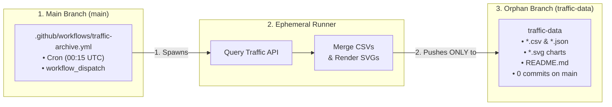
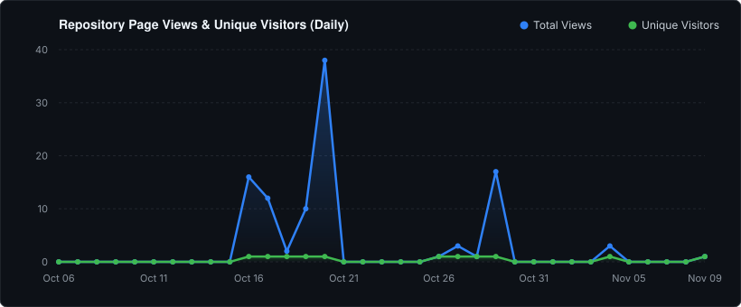
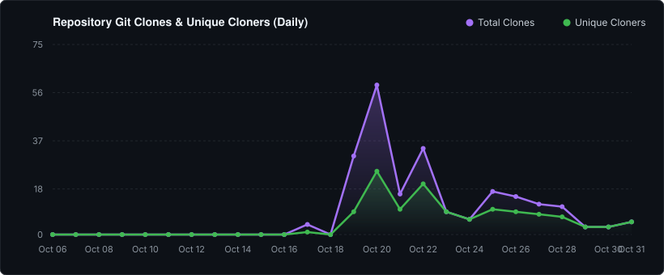

# 📊 Claude Autopilot — Traffic & Adoption Dashboard

*Last updated: 2026-11-10 07:09 UTC*

This branch (`traffic-data`) permanently archives repository telemetry, overcoming GitHub's 14-day rolling window deletion policy. All time-series data is persisted exclusively to this orphan branch, keeping `main` 100% clean.

---

## 📈 Lifetime Key Performance Indicators (KPIs)

| Metric | All-Time Total |
| :--- | :--- |
| **Total Page Views** | 104 |
| **Cumulative Daily Uniques** | 11 |
| **Total Git Clones** | 323 |
| **Unique Git Cloners** | 188 |

---

## 📉 Views & Visitor Trends

---

## 📦 Git Clones Trend

---

## 🌐 Top Referring Domains (All-Time)

| Domain | Total Hits | Unique Visitors | % of Total Traffic |
| :--- | :--- | :--- | :--- |
| `github.com` | 56 | 26 | 100.0% |

---

## 📄 Top Documentation Paths (Document Heatmap)

| Document / Path | Page Views | Unique Readers |
| :--- | :--- | :--- |
| **/tree/main** (`/urvijain02/claude-autopilot/tree/main`) | 121 | 11 |
| **/pulls** (`/urvijain02/claude-autopilot/pulls`) | 108 | 16 |
| **/actions** (`/urvijain02/claude-autopilot/actions`) | 70 | 14 |
| **/pull/4** (`/urvijain02/claude-autopilot/pull/4`) | 70 | 14 |
| **Overview** (`/urvijain02/claude-autopilot`) | 51 | 26 |
| **/actions/workflows/traffic-archive.yml** (`/urvijain02/claude-autopilot/actions/workflows/traffic-archive.yml`) | 42 | 14 |
| **/pull/2** (`/urvijain02/claude-autopilot/pull/2`) | 40 | 14 |
| **/tree/main/hooks** (`/urvijain02/claude-autopilot/tree/main/hooks`) | 22 | 11 |
| **/actions/runs/39410164482** (`/urvijain02/claude-autopilot/actions/runs/39410164482`) | 13 | 13 |
| **/actions/runs/39410164482/job/118585688863** (`/urvijain02/claude-autopilot/actions/runs/39410164482/job/118585688863`) | 13 | 13 |
| **/actions/runs/39072240583/job/117512071539** (`/urvijain02/claude-autopilot/actions/runs/39072240583/job/117512071539`) | 12 | 12 |
| **/actions/runs/39072240583/job/117512071719** (`/urvijain02/claude-autopilot/actions/runs/39072240583/job/117512071719`) | 12 | 12 |
| **/actions/runs/39413793156** (`/urvijain02/claude-autopilot/actions/runs/39413793156`) | 8 | 8 |
| **/blob/main/LICENSE** (`/urvijain02/claude-autopilot/blob/main/LICENSE`) | 6 | 6 |
| **/tree/main/agents** (`/urvijain02/claude-autopilot/tree/main/agents`) | 6 | 6 |

---

*Automated repository telemetry archived nightly at 00:15 UTC via Claude Autopilot Traffic Archiver.*
